# MyGo API

[](https://github.com/fayvo-hub/mygo-api/actions/workflows/ci.yml)
[](https://github.com/fayvo-hub/mygo-api/actions/workflows/release.yml)

纯本地的轻量级 Postman：请求构建、发包、响应查看、集合与历史管理全部在这台机器上完成，不连云端、不需要后端服务。界面文案全部中文。

技术形态：Go 写桌面壳（[MyGo](https://mygo.egoist.dev/)）+ 系统 webview 里的 Vite/TypeScript 前端，HTTP 请求由 Go 侧发出（借 MyGo 的 fetch 插件），因此不受浏览器 CORS 限制，可以任意设置请求头与 Cookie。

设计取舍与功能清单见 `docs/mygo-调研与功能清单.md`；**界面规范见 `docs/设计系统.md`**（改 UI 前的权威依据，`npm run lint:ui` 检查硬编码色值/字号/圆角/阴影）。

## 下载

安装包由 GitHub Actions 在打 tag 时构建并挂到 [Releases](https://github.com/fayvo-hub/mygo-api/releases)：

| 平台 | 产物 | 说明 |
| --- | --- | --- |
| Windows 10/11 | `mygo-api-setup-<版本>-amd64.exe` | 按用户安装到 `%LOCALAPPDATA%\Programs\MyGoAPI`，不需要管理员权限；需要 WebView2（Win11 自带） |
| Windows 免安装 | `mygo-api-<版本>-portable.exe` | 单文件双击即用，适合放 U 盘或临时机器 |
| macOS 12+ | `mygo-api-<版本>.dmg` | Apple Silicon 与 Intel 通用；未做代码签名，首次打开请右键 →「打开」 |

安装包没有代码签名：Windows 首次运行会被 SmartScreen 拦一次（「更多信息」→「仍要运行」）。想自己编译见「[打包与安装](#打包与安装)」。

## 界面

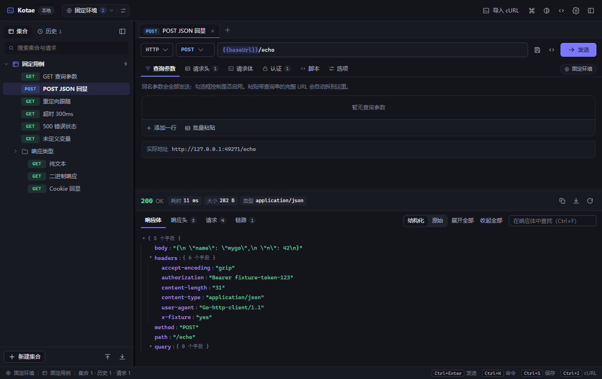

| 功能 | 截图 |
| --- | --- |
| 结构化响应：默认全展开，可一键收起/展开，左侧竖线标层级 | 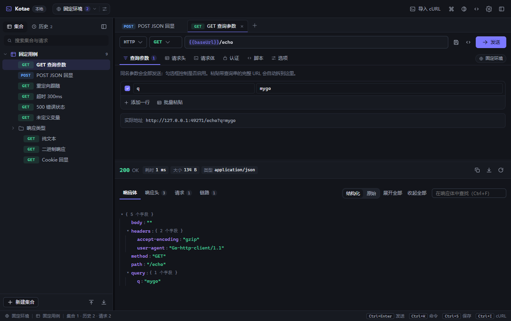 |
| 请求脚本：前置算 HMAC 签名，响应区顶部显示脚本日志 | 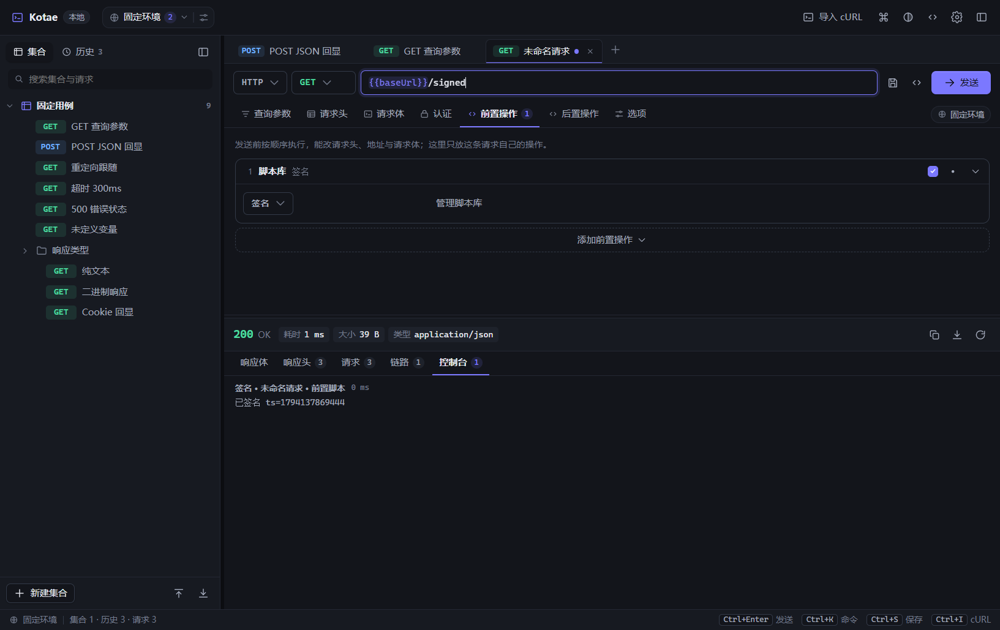 |
| 流式面板：WebSocket 连上后收发消息（SSE 同一套面板） | 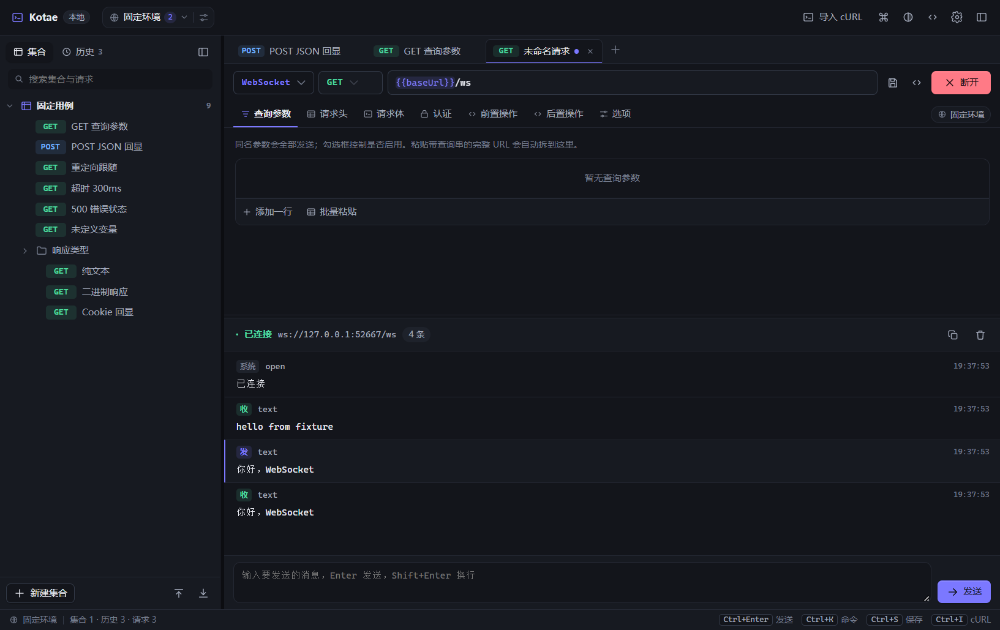 |
| 环境变量：多环境、值遮罩、批量粘贴 | 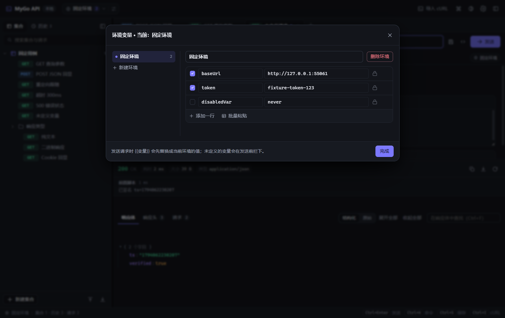 |
| cURL 导入：粘贴命令即出解析预览，可替换当前请求或新开标签 | 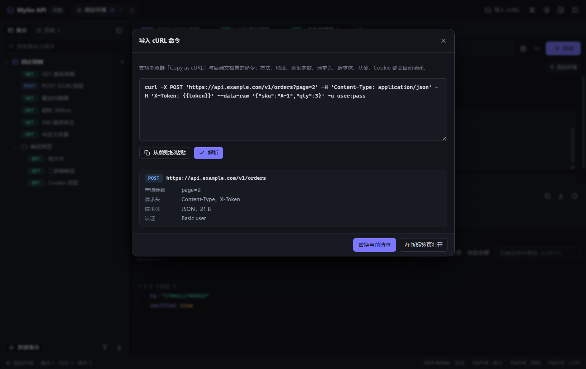 |
| 导入 Postman Collection / HAR：先预览再合并 | 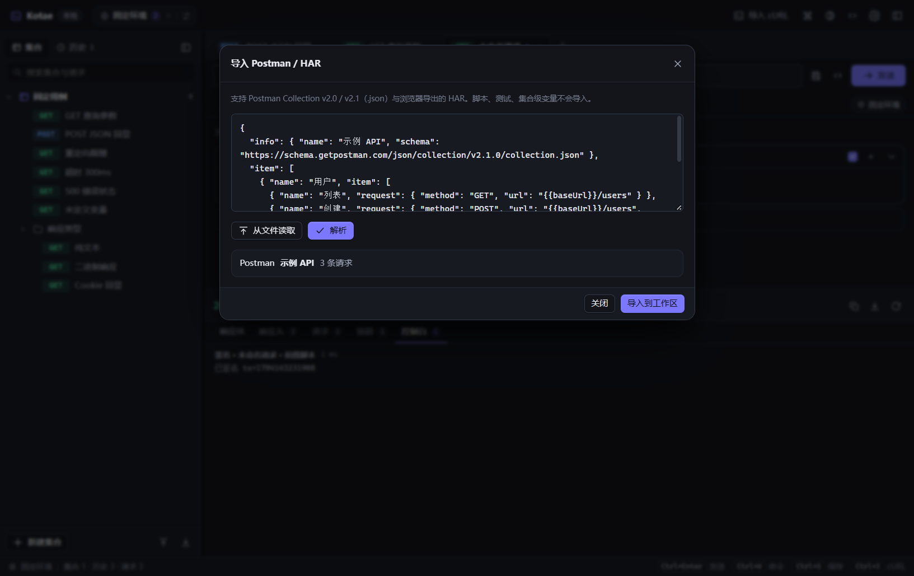 |
| 命令面板：命令、集合里的请求、历史一起搜 | 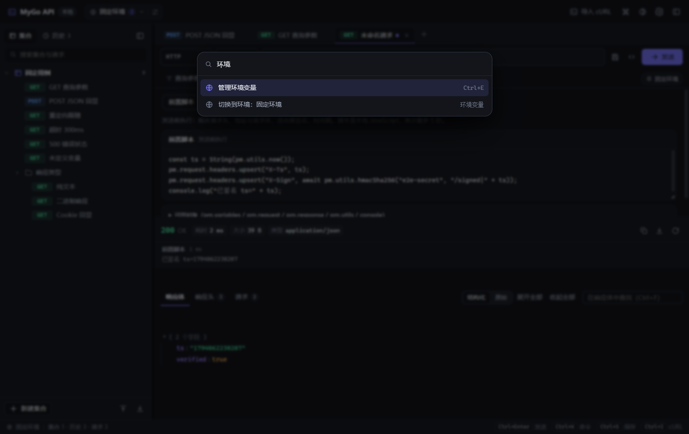 |
| 设置：外观、全局变量、动态变量、数据备份、桌面开关 | 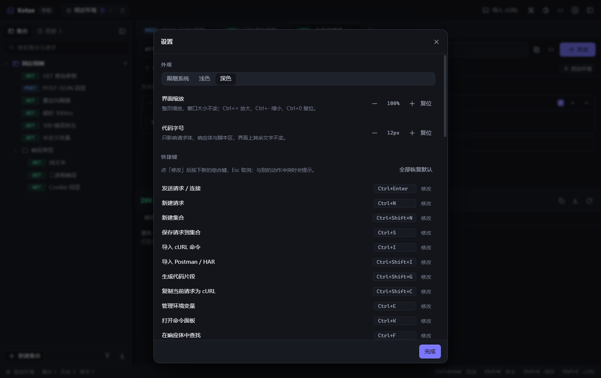 |
| 历史：状态码与耗时，可重放或删除 | 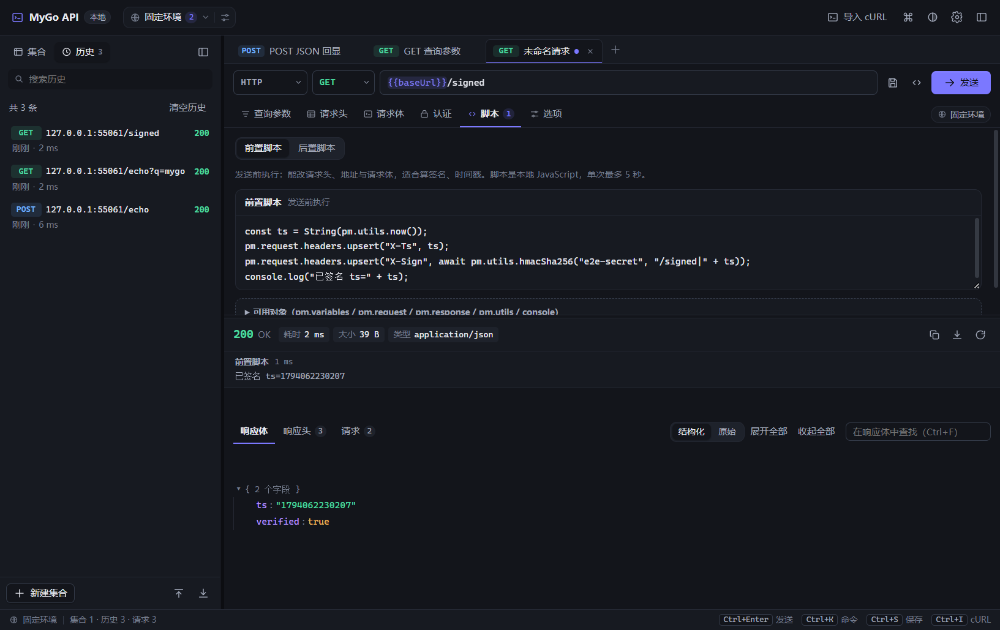 |
| 浅色主题（跟随系统 / 浅色 / 深色三档） | 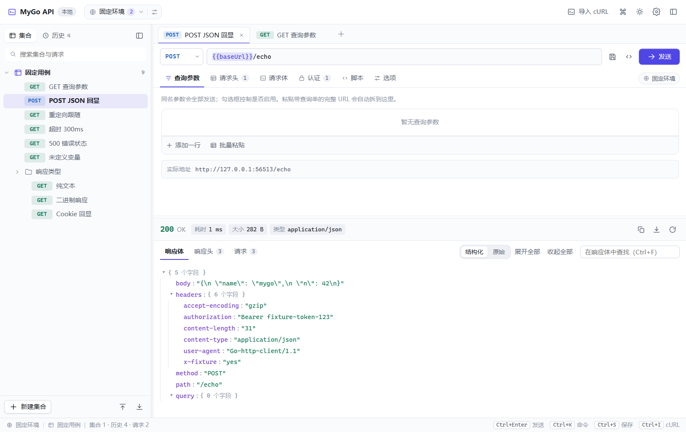 |
| 浅色主题下的流式面板 | 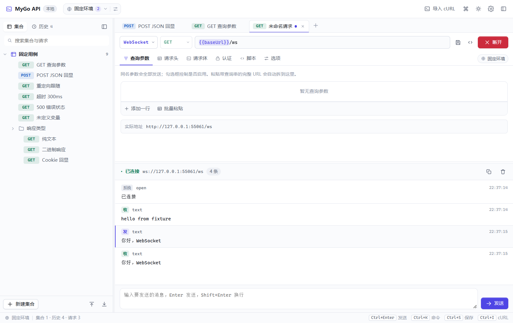 |

截图由端到端测试生成，数据是本机桩服务的固定测试数据，不碰你自己的工作区：

```bash
MYGO_E2E_SCREENSHOTS=1 go test -tags e2e ./e2e/ -run TestScreenshots -count=1
```

## 功能

- **请求构建**：GET/POST/PUT/PATCH/DELETE/HEAD/OPTIONS；查询参数与请求头表格（启用开关、批量粘贴——打开时预填当前行、行首加 `#` 即禁用、取消不改数据、清空内容即清空表格、同名键全发送）；请求体支持 JSON / 纯文本 / 表单编码 / 含文件的 multipart 表单 / 二进制文件直传 / GraphQL（查询与变量分栏，发送时合成 `{"query","variables"}`）；地址里写 `/users/:id` 时自动列出路径变量表；认证支持 Bearer、Basic、API Key（头部或查询串），集合与文件夹可以设共享认证与变量并向下继承；逐请求超时、重定向策略（跟随/手动/报错）、Cookie 开关、自定义代理（`http`/`https`/`socks5`）与跳过 TLS 校验。地址栏右侧只留保存到集合与代码片段两个动作：导入 cURL 在顶栏与 Ctrl+I，复制 cURL 在代码片段里选 cURL 或 Ctrl+Shift+C，同一件事不出现两个入口。
- **发送与取消**：发送中可取消；窗口不在前台时用系统通知提示完成。
- **流式与长连接**：请求协议除了默认的 HTTP，还能切成 SSE 与 WebSocket。SSE 边收边显示（按事件块解析 `event` / `data` / `id`，注释行当心跳丢弃，多行 `data` 拼成一条），WebSocket 由 Go 侧完成握手，因此可以带任意握手头（`Authorization`、`Cookie` 都行），子协议从 `Sec-WebSocket-Protocol` 头里取；两种连接都能看到状态（连接中 / 已连接 / 已断开 / 连接失败）、耗时、消息条数，消息分「收 / 发 / 系统」三类，可清空、可复制全部；WebSocket 消息在面板底部的输入框里发（Enter 发送，Shift+Enter 换行，草稿按标签页保存），点「断开」或按 Esc 断开。单个连接最多保留 500 条消息、单条最多 256 KB，超出会裁掉并提示。
- **请求脚本**：每个请求带前置与后置两段 JavaScript，写法贴近 Postman 的 `pm`（`pm.variables` / `pm.environment` / `pm.globals` / `pm.request` / `pm.response` / `pm.utils` / `console`）。前置在发送前跑，能改请求头、地址与请求体（自动签名、时间戳都靠它）；后置拿到响应后跑，能改写响应体（解密、脱敏、重排）；可用的 `pm.utils` 有 HMAC-SHA256、SHA-256、Base64 编解码、`now`、`uuid`、`randomInt`、`queryString`，单次最多 5 秒。脚本里的 `pm.test(name, fn)` 会真的跑：响应区顶部列出每条断言的通过与失败并汇总「断言 x/y」，异步断言会等结果再渲染。执行日志与报错同样显示在响应区顶部；从导入的集合里带进来的脚本默认不执行，脚本页会标出「信任并启用」，点了才跑。
- **cURL 互转**：粘贴整条 cURL 命令自动还原成请求（也支持粘贴到地址栏直接识别）；任意请求可一键复制成 cURL。
- **响应查看**：状态码/耗时/大小/类型；耗时悬停可看「等待响应 + 下载正文」的拆分，跟随重定向时提示最终地址；「链路」页签逐跳列出重定向的方法、地址与状态码，并给出 DNS 解析 / 建立连接 / TLS 握手 / 等待首字节 / 总计的分阶段耗时；JSON 结构化折叠树（默认全部展开，可一键收起全部/展开全部；单层超 200 项时分页折叠）与原始文本双视图，HTML/XML 高亮；响应体关键词高亮查找；响应头筛选与逐条复制；响应体保存到本地文件（二进制响应按原始字节写盘）；图片响应直接在面板里预览，其他二进制给十六进制片段（超过 2 MB 只保留前 2 MB 并提示）；「请求」页签记录本次实际发出的方法、地址、请求头、请求体与选项（变量已插值、认证头已合并），排查用。
- **集合与历史**：集合/文件夹/请求三级树，集合、文件夹、请求都能重命名（右键菜单或双击就地编辑）、复制、删除，节点右侧的悬停按钮与右键菜单提供同一批动作；标签页多开、脏标记、保存与另存；最近 200 条历史，可单条删除或清空。
- **环境变量与插值**：多环境 + 全局变量，`{{name}}` 插值，内置动态变量（`{{$timestamp}}`、`{{$uuid}}`、`{{$randomInt}}` 等）；参数、请求头、表单、环境变量表、地址栏、请求体、cURL 导入框输入 `{{` 时都会补全已有变量名；环境与全局变量行尾的锁按钮能把值遮成密码（只影响显示，发送仍用真实值）；未定义变量在发送前拦下提示。顶栏的环境胶囊左侧点击展开下拉（切换环境、新建环境、进入管理），右侧的编辑按钮直达变量面板；请求区子页签行右侧也有一枚同款胶囊。
- **地址栏**：支持 `{{变量}}` 模板，变量片段带底色与悬停提示（悬停可看到解析后的值与未定义项），下方「实际地址」随输入实时更新；失焦不会改写你写的地址，协议只在发请求时按解析结果兜底（`{{baseUrl}}` 自带 `https://` 时不会被拼成双协议）。
- **导入导出**：工作区备份导出为 JSON、导入时合并到现有数据；导入 Postman Collection（v2.0 / v2.1）与浏览器 HAR 成集合（带认证、请求体、禁用的头），也能把全部集合导出成 Postman Collection；双击 `.har` 文件直接用本应用打开并进入导入浮层。
- **Cookie 管理器**：看得到 Go 侧 Cookie 罐里的每一条（域名、路径、过期、Secure/HttpOnly），可筛选、单条删除、一键清空。
- **交互效率**：命令面板（Ctrl+K）、17 个动作的快捷键且可在设置里改成自己的键位（冲突会被挡下，可一键恢复默认）、集合树拖拽排序、拖进拖出文件夹；一键生成 fetch / axios / Python requests / cURL 代码片段（变量已替换）；可拖拽侧边栏与响应区分割、跟随系统/浅色/深色主题、界面缩放（70%–200%，Ctrl+`=` / Ctrl+`-` / Ctrl+0）与代码字号（10–20px）、首次启动引导页。
- **更新**：设置面板「更新」一节可检查更新并开关后台自动检查与自动下载安装，托盘菜单也有「检查更新…」；开发版或包管理器安装的版本会说明本构建不能自我更新。
- **明确不做**（与"轻量、纯本地"冲突）：录制代理、集合运行器与批跑、压测、云同步与团队协作、OpenAPI 生成请求、完整断言框架。

## 开发

```bash
npm install                 # 安装前端依赖
npm run generate            # 生成 src/mygo.ts（Go 方法 → TypeScript 客户端）
npm run dev                 # mygo dev：起 Vite + 编译并启动应用窗口
npm run typecheck           # TypeScript 类型检查
npm run build               # 产出 build/<os>-<arch>/（Windows 含 NSIS 安装包）
npx mygo-cli build -skip-installer   # 只出可执行文件，跳过安装包
npx mygo-cli vet .          # go vet + 原生 UI 生命周期检查
```

修改 Go 侧公开方法后必须重跑 `npm run generate`，否则前端拿到的客户端类型是旧的。

## 快捷键

| 快捷键 | 作用 |
| --- | --- |
| Ctrl+Enter | 发送请求 |
| Ctrl+N | 新建请求标签页 |
| Ctrl+S | 保存请求到集合 |
| Ctrl+Shift+N | 新建集合 |
| Ctrl+I | 导入 cURL |
| Ctrl+Shift+I | 导入 Postman Collection / HAR |
| Ctrl+Shift+G | 生成代码片段 |
| Ctrl+Shift+C | 复制当前请求为 cURL |
| Ctrl+K | 命令面板 |
| Ctrl+E | 环境变量 |
| Ctrl+B | 收起/展开侧边栏 |
| Ctrl+F | 在响应体中查找 |
| Ctrl+W | 关闭当前标签页 |
| Ctrl+, | 设置 |
| Ctrl+Shift+M | 全局快捷键：显示/隐藏主窗口（可在设置里关掉） |
| Esc | 关闭浮层 / 取消发送中的请求 / 断开流式连接 |

标签页上有右键菜单：刷新（重发当前请求）、关闭、关闭其他、关闭全部；集合树里的集合、文件夹、请求也各有右键菜单（新建、重命名、复制、删除等），双击任意节点直接就地改名。菜单跟着点击位置弹出，滚轮或改窗口大小、按 Esc 会自动收起。

## 数据存储

存储层是 SQLite：整个工作区（集合、文件夹、请求、历史、环境与变量、标签页、界面偏好、是否关闭到托盘）都落在一个文件里——MyGo userData 目录下的 `workspace.db`。路径可在「设置 → 关于」看到，并可用同行的「打开数据目录」直接打开。

- 驱动是 MyGo 的 sqlite 插件（`@mygo-plugins/sqlite` + Go 侧 `mygo.Use(sqlite.Plugin)`）：预编译的 sqlite3 通过 purego 加载，不需要 cgo；`mygo dev` / `mygo build` 会把对应平台的原生库打进产物，想换自编译版本可用环境变量 `MYGO_SQLITE_LIBRARY` 指定。
- 建表语句在 `src/db.ts` 的 `SCHEMA` 里：`collections` / `folders` / `requests` / `history` / `environments` / `variables` / `tabs` / `settings` / `meta`。集合树的层级与顺序由 `position` 列还原，文件夹与请求共用一个序号空间。
- 写入用 WAL 模式 + `busy_timeout`，每次保存只提交与上次快照不同的行（`INSERT … ON CONFLICT DO UPDATE` 与按主键 `DELETE`），整批包在一个 `BEGIN IMMEDIATE` 事务里；界面上的连续编辑由 220ms 防抖合批。
- 从旧版本升级时，首次启动会把 `workspace.json` 读进来迁进数据库，然后把原文件改名成 `workspace.json.bak`（不删除；解析失败则跳过迁移并在界面提示）。桌面的 `desktop.json` 已经取消，偏好并入 `settings` 表。
- 整个数据目录可以删掉，应用会从头开始。

## 测试

端到端测试在 `e2e/`，用真实二进制、真实窗口跑，不依赖浏览器自动化库：应用在 `-tags e2e` 构建下链接 MyGo 的 Automation 插件，测试通过本机 Unix socket 驱动页面（`eval` 执行脚本、`capture` 截图），再启动第二个实例模拟双击图标与深链。

```bash
npm run e2e                        # 跑全部用例：先构建前端，再编译 e2e 二进制并启动
npm run e2e:verbose                # 带每个用例的输出与截图名称
MYGO_E2E_SKIP_BUILD=1 npm run e2e  # 前端没改动时跳过 npm run build:web
MYGO_E2E_KEEP=1 npm run e2e        # 保留临时目录（含应用日志）便于事后排查
MYGO_E2E_PACKAGING=1 npm run e2e   # 追加验证打包产物：跑一次 mygo build，断言界面来自二进制
MYGO_API_E2E_WINDOW=visible npm run e2e  # 把被测窗口留在原位（默认挪到屏幕外，不挡你正在做的事）
```

覆盖率（默认 82 个用例，`MYGO_E2E_PACKAGING=1` 再跑 1 个打包用例，共 83 个）：首屏与固定数据加载、GET/POST 发送与保真（方法、头、查询串、认证）、重定向、错误状态码、超时中文提示、未定义变量拦截、纯文本与二进制响应、Cookie 罐、cURL 导入与导入后发送、导出 cURL 不丢查询串里的 API Key、保存对话框与新建集合、环境变量面板、环境胶囊下拉与编辑入口、地址栏变量高亮与不自动补协议、命令面板、主题切换、历史记录、结构化视图默认全展开并可一键收起/展开、响应区「请求」页签展示实际发出的请求快照、批量粘贴对话框（多行输入、Enter 换行、点遮罩不关闭、Ctrl+Enter 提交、预填已有行与 `#` 禁用、不改内容时点取消或确定都不改动数据）、表单文件行的删除按钮不与文件按钮重叠、集合树拖拽排序与拖进移出文件夹（拖回原位后整串标签完全一致）、耗时拆分与重定向最终地址提示、代码片段生成与复制、Postman 与 HAR 导入（含认证/请求体/禁用头）与导出入口、图片响应的内联预览与二进制十六进制片段、变量补全在地址栏与请求体里生效、环境变量值遮罩、标签页右键菜单的刷新与三种关闭、前置脚本算 HMAC 签名后服务端验签通过、后置脚本改写响应体、导入脚本默认不执行并需手动信任、全按钮巡检（每个界面的控件都要有名字、有尺寸、中心点真能点中；请求区与响应区每个页签、请求体七种模式、四种认证方式、脚本前后两阶段都要能切过去；顶栏与响应区的按钮都要有实际结果；标签页加号与关闭、清空历史、环境面板的新建/删除环境与加变量行、首次启动引导三个入口、发送中的「取消」真的中断请求并显示「请求已取消」、集合树右键菜单与就地改名、SSE 边收边显示与多行 data 拼接、WebSocket 握手取子协议且收发回显、协议切回 HTTP 后不残留流式面板、自定义代理真的走代理、跳过 TLS 校验能连自签证书、链路页签的逐跳与耗时拆解、GraphQL 查询与变量的分栏与切换保真、路径变量替换进路径、`pm.test` 断言的通过与失败汇总、Cookie 管理器筛选与删除、集合/文件夹共享认证与变量向下继承并在重启后仍在）、窗口默认挪到屏幕外且渲染没有被节流；存储层：`workspace.json` 一次性迁移成 `workspace.db`、新建集合后连续重启两次数据仍在（证明写的是数据库而不是内存）、侧边栏折叠状态与桌面偏好（关闭到托盘、全局快捷键）跨重启保持；桌面层：深链导入、关闭到托盘后从第二个实例恢复窗口。

固定测试数据在 `e2e/fixtures/workspace.json`，只在 e2e 里用（以旧版 JSON 工作区的形式投喂，启动时走一次真实的迁移路径）：测试每次复制到临时目录作为 userData 再启动应用，占位符 `__BASE_URL__` 会替换成本地桩服务的随机端口，所以不会碰到你本机的工作区。桩服务在 `e2e/echo.go`（回显请求、慢响应、重定向、错误码、Cookie、二进制、文本、五层嵌套 JSON、HMAC 验签、base64 响应体），流式端点在同目录的 `e2e/stream.go`（SSE 逐条推事件；WebSocket 用 Go 手写的 RFC 6455 握手与帧编解码，不引第三方库）。截图写到 `e2e/artifacts/`（已 gitignore）。

## 桌面集成

- **没有系统菜单栏**：窗口顶部只有应用自己的工具栏。动作都在界面里（顶栏按钮、命令面板、标签页右键菜单）或快捷键里，托盘菜单承担「没有窗口时也能操作」的那部分。窗口更干净，也不用维护两套入口。
- **分栏**：侧边栏宽度与响应区高度可拖拽，双击分隔条复位到默认值（288px / 340px）；拖拽范围与读回数据库时的钳制范围一致，重启不会把尺寸悄悄改掉。
- **托盘**：左键单击图标直接显示主窗口；右键弹出菜单（显示主窗口、新建请求、导入 cURL、检查更新、关闭到托盘开关、全局快捷键开关、退出）；`Ctrl+Shift+M` 在应用不在前台时也能显示/隐藏窗口（注册失败只记日志，不影响其它功能），两个开关同样出现在设置面板的「桌面」一节，状态存在数据库里。关闭窗口时按该开关隐藏窗口而不是退出（默认开启），偏好存在数据库的 `settings` 表里，启动时由页面交给 Go 侧。Linux 需要 `libayatana-appindicator3`，未安装时托盘创建失败会被记日志，应用其余部分照常工作。
- **单实例与深链**：第二次启动不会开新窗口，参数转给已在运行的实例。支持 `mygo-api://new`、`mygo-api://settings`、`mygo-api://import?curl=<URL 编码的 cURL>`，最后一种会直接把命令送进导入浮层并自动解析。双击 `.har` 文件（已关联）会把文件内容读进来直接解析成集合，超过 16 MB 的文件会提示手动选择。
- **关于面板**：走系统标准面板（`ShowAboutPanel`），应用名与版本取自构建时的配置。

## 打包与安装

元数据都在 `mygo.config.ts`：`name`（用户看到的名字，安装包与快捷方式用它）、`slug`（安装包文件名、Debian 包名等纯 ASCII 场景）、`identifier`（系统登记用的反向域名）、`icon`、`windows.displayName` / `windows.installDirName`（Windows 显示名与 `%LOCALAPPDATA%\Programs\MyGoAPI` 目录名）、`linux.*`（Debian 包与 desktop 条目）、`urlSchemes`（深链）。

```bash
npm run build                         # build/windows-amd64/：MyGo API.exe + mygo-api-setup-0.2.0-amd64.exe
npx mygo-cli build -skip-installer    # 只要可执行文件
npx mygo-cli build -platform linux/amd64,darwin/universal   # 交叉编译（需要各平台的打包工具）
```

Windows 安装包是 NSIS 做的按用户安装：装到 `%LOCALAPPDATA%\Programs\MyGoAPI`，建开始菜单快捷方式，完成页可勾选桌面快捷方式，卸载项出现在「设置 → 应用」（显示名、版本、发布者取自上面的配置）。支持 `/S` 静默安装，卸载同样支持 `/S`；卸载会删掉程序目录、快捷方式与卸载注册项，**不会删** userData 里的工作区数据——那是用户资产，需要的话自己删。NSIS 未安装时 mygo 会自己下载一份。SQLite 的原生库（Windows 上是 `mygo-sqlite3.dll`，约 1.4 MB）由 `mygo build` 自动放到可执行文件旁边并一起打进安装包，所以安装后的目录里有它，不用额外装数据库。macOS 出 `.app` 与 `.dmg`，Linux 出可执行文件、`.deb`、`.tar.gz`（含 install.sh）与 PKGBUILD。

### 代码签名与自动更新

两者都需要真实证书或密钥，仓库里不存放。**自动更新已启用**（`updates` 配了 `publicKey` 与 `github`，私钥只在发布机上）；**代码签名仍未启用**，`windows.certificate` / `macos.signingIdentity` 以注释形式写好了字段名，接入时取消注释填入即可。

- Windows 代码签名：配 `windows.certificate`（.pfx 路径）并设置环境变量 `MYGO_WINDOWS_CERTIFICATE_PASSWORD`，时间戳服务用 `windows.timestampUrl`；也可以改用 `windows.signCommand`（`%1` 是待签文件路径）。**没有签名的安装包会被 SmartScreen 拦一次**，属于预期行为。
- macOS 签名与公证：`macos.signingIdentity` + `macos.notarize.keychainProfile`；未签名时用户要手动「右键 → 打开」。
- 自动更新：`updates` 已配好（`publicKey` + `github: fayvo-hub/mygo-api` + `tagPrefix: v` + `changelog: CHANGELOG.md`）。发布机设好 `MYGO_UPDATER_PRIVATE_KEY` 后，构建会额外产出签名更新包与 `update-<platform>.json`；没有私钥时构建照常出安装包，只是不带更新文件。密钥对由 `npx mygo-cli keygen` 生成，公钥写进配置、私钥不入库。发布说明取自 `CHANGELOG.md` 里 `## <版本>` 那一段，没有这一段打包会报错。

### 持续集成

`.github/workflows/ci.yml` 三个 job：

| job | 触发 | 做什么 |
| --- | --- | --- |
| `web` | 每次推送 / PR | `npm ci` → `typecheck` → `lint:ui` → `build:web` |
| `windows` | 每次推送 / PR | `go vet` → `mygo-cli vet` → `build:web` → `mygo-cli build -skip-installer`，产物作为 artifact 上传 |
| `e2e` | 手动触发（Actions 页面「Run workflow」） | 在 Windows runner 上跑真实窗口的端到端用例，失败时上传截图 |

端到端用例没有挂在每次推送里：它要开真实窗口、要 WebView2 与桌面会话，比静态检查慢且更依赖 runner 环境，所以留成手动触发，日常靠本地 `npm run e2e`。

### 发布

`.github/workflows/release.yml` 在推送 `v*` tag（或在 Actions 页面手动触发）时构建两个平台的安装包并挂到 GitHub Release：

```bash
# 发布 0.2.0：先把 mygo.config.ts 的 version 改成 0.2.0 并提交
git tag v0.2.0
git push origin v0.2.0
```

两个平台并行构建：`windows-latest` 跑 `mygo-cli build -platform windows/amd64`（出 exe、NSIS 安装包，并把裸 exe 改名成 `mygo-api-<版本>-portable.exe`），`macos-latest` 跑 `-platform darwin/universal`（出 `.app` 与 `.dmg`），最后由 `release` job 汇总上传。没有配签名证书时构建带 `-skip-notarize`，产物能装能跑但需要用户手动放行；接入签名后去掉这个参数，并按上一节补配置。

发完整流程（版本号对齐清单、资产核对命令、重发同一版本、失败排查）见 `.agents/skills/mygo-release/SKILL.md`。

### 发布检查清单

1. 改 `mygo.config.ts` 的 `version`（同时更新 README 状态栏截图里的版本文案不必改，它读的是构建配置）。
2. `npm run typecheck && npm run lint:ui && go vet ./... && npx mygo-cli vet . && npm run e2e`。
3. `npm run build`，确认 `build/windows-amd64/` 里有 exe、`mygo-sqlite3.dll` 与 setup 安装包。
4. 装一次安装包（含 `/S` 静默安装）验证快捷方式、卸载项与「数据目录保留」。
5. 打 tag 触发发布流水线：`git tag vX.Y.Z && git push origin vX.Y.Z`；要签名/自动更新的话先按「代码签名与自动更新」补配置，并把 `release.yml` 里的 `-skip-notarize` 去掉。
6. 等 5 分钟左右到 Release 页面确认资产齐了：setup 安装包、portable、dmg 三个都在。

图标由 `scripts/make-icons.py` 生成（需要 Pillow）：`python scripts/make-icons.py` 会重写 `resources/icon.png`（1024×1024 应用图标）与 `resources/tray.png`（32×32 托盘图标），两者是同一套品牌渐变加 `>_` 字形，改配色只改脚本顶部的两个颜色常量。
